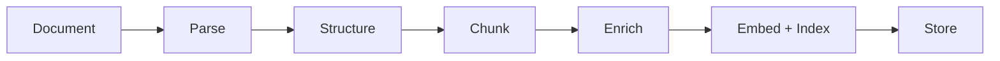

<div align="center">
  <h1>Ingestible</h1>
  <p>
    Parse, chunk, enrich, and embed documents for AI retrieval.<br>
    PDF, DOCX, HTML, EPUB, PowerPoint, Excel, CSV, Markdown, RST, AsciiDoc, plain text, audio, video, images, email, XML, JSON, and ZIP archives.
  </p>
</div>

<p align="center">
  <a href="LICENSE"></a>
  
  
</p>

---

Instead of dumping 90,000 tokens into an LLM context window, Ingestible gives your AI a **structured map** of the document and **hybrid search** across three indexes — so each query costs ~1,000-2,000 tokens instead.

```
513-page book:  92,598 tokens full  →  ~1,317 tokens per query  (99% reduction)
55-page paper:   4,975 tokens full  →    ~585 tokens per query  (88% reduction)
```

## How It Works



| Stage | What happens |
|-------|-------------|
| **Parse** | Format-specific extraction → clean markdown. PDF uses IBM Docling for deep layout analysis, PyMuPDF fallback, automatic OCR if text is sparse. |
| **Structure** | Builds hierarchy tree from TOC tables, heading patterns, or page range heuristics. |
| **Chunk** | Splits into 4 levels (L0-L3). Tables and code blocks stay atomic. ~10% overlap. Small trailing chunks get merged. |
| **Enrich** | Bottom-up LLM pass (L3→L0) generates summaries, concepts, hypothetical questions, entities. Skippable. |
| **Embed** | E5-large-v2 vectors (ChromaDB, MPS-accelerated) + BM25 sparse index + concept→chunk mapping. |
| **Store** | JSON file hierarchy under `data/documents/{doc_id}/`. |

**The 4-level chunk hierarchy:**

| Level | What | Size | Purpose |
|-------|------|------|---------|
| L0 | Document overview + TOC + executive summary | ~500-800 tokens | Map of the entire document |
| L1 | Chapters | ~300-500 tokens | Browsing units |
| L2 | Sections | ~200-400 tokens | Section summaries |
| L3 | Passages | ~250-500 tokens | Primary search targets |

**Three search indexes, fused with Reciprocal Rank Fusion (RRF):**

- **Vector** (ChromaDB + E5-large-v2) — semantic meaning
- **BM25** (rank-bm25) — keyword matching
- **Concept index** — direct concept-to-chunk lookup

Passages found by multiple indexes rank higher. No score normalization needed.

## Features

- **25+ input formats** — PDF, DOCX, HTML, EPUB, PPTX, XLSX, CSV, Markdown, RST, AsciiDoc, plain text, audio, video, images (PNG/JPG/TIFF/BMP/WebP), email (EML/MSG), XML, JSON/JSONL, ZIP (Notion, Confluence, generic)
- **4-level chunk hierarchy** — L0 overview → L1 chapters → L2 sections → L3 passages, no mid-paragraph splits
- **LLM enrichment** — summaries, concepts, hypothetical questions, entities, cross-references (one-time cost, skippable)
- **Hybrid search** — vector + BM25 + concept index, fused with RRF. Optional cross-encoder reranking.
- **Cross-document corpus search** — query across all ingested documents at once
- **Extraction profiles** — auto-detected (paper, article, documentation, general) with tailored enrichment
- **Knowledge graph extraction** — entity-relationship triples from enrichment (auto-enabled for papers and docs)
- **Smart re-ingestion** — content-hash dedup, selective re-enrichment (unchanged chunks skip LLM), version archival, checkpoint/resume
- **File watcher** — `ingest watch` monitors a directory and auto-ingests on changes, with optional CV push
- **Export** — jsonl, parquet, llamaindex, langchain formats
- **CLI + REST API + Web UI** — ingest and search from anywhere
- **Docker-ready** — one-command deployment with persistent storage
- **Production-grade** — rate limiting, structured logging, Prometheus metrics, background ingestion, file locking, graceful shutdown
- **MCP server** — AI agents (Claude, GPT) can ingest and search directly via Model Context Protocol
- **Retrieval evaluation** — measure Hit Rate, MRR, Precision@K with synthetic or manual queries
- **Cloud storage** — ingest from S3, GCS, Azure Blob (`s3://`, `gs://`, `az://`)
- **Zero cloud dependencies** — embeddings run locally (CPU/Apple Silicon MPS). LLM enrichment is optional.

## Quickstart

```bash
git clone https://github.com/simplyliz/Ingestible.git
cd Ingestible

# Requires Python 3.11-3.12 (ChromaDB incompatible with 3.14)
python3.12 -m venv .venv
source .venv/bin/activate
pip install -e ".[dev]"

# Ingest without API keys (skips LLM enrichment, still builds all search indexes)
ingest ingest /path/to/document.pdf -v --skip-enrichment

# List ingested documents
ingest list

# Search within a document
ingest search <doc_id> "your query here"

# Search across all documents
ingest corpus-search "your query here"
```

**First run downloads the E5-large-v2 embedding model (~1.3GB). Runs locally on CPU/Apple Silicon MPS.**

### With Docker

```bash
cp .env.example .env
# Add your API keys to .env

docker compose up -d
```

The API and web UI are available at `http://localhost:8081`. Document data is persisted via a Docker volume.

The container runs behind gunicorn with multiple workers. Monitor via `/health/ready` and `/metrics`.

### With LLM Enrichment

Enrichment adds summaries, hypothetical questions, and concept tags to each chunk — significantly improving search precision. One-time cost per document.

```bash
cp .env.example .env
# Add your OpenAI or Anthropic API key

ingest ingest /path/to/document.pdf -v
```

| Document size | Estimated enrichment cost (gpt-4o-mini) | Time |
|---------------|----------------------------------------|------|
| 55 pages | ~$0.01 | ~1 min |
| 500 pages | ~$0.20 | ~5 min |
| 1,000 pages | ~$0.50 | ~10 min |

## Supported Formats

| Format | Extensions | Notes |
|--------|-----------|-------|
| PDF | `.pdf` | Text + scanned/OCR via Docling |
| Markdown | `.md` | |
| DOCX | `.docx` | |
| HTML | `.html`, `.htm` | |
| EPUB | `.epub` | |
| PowerPoint | `.pptx` | |
| Excel | `.xlsx` | |
| CSV | `.csv` | |
| reStructuredText | `.rst` | |
| AsciiDoc | `.adoc` | |
| Plain text | `.txt` | |
| Audio | `.mp3`, `.wav`, `.m4a`, `.flac`, `.ogg`, `.aac`, `.opus` | ASR via faster-whisper, timestamped |
| Video | `.mp4`, `.mkv`, `.avi`, `.mov`, `.webm`, `.wmv`, `.flv` | Audio extraction + ASR + keyframes |
| Images | `.png`, `.jpg`, `.jpeg`, `.tiff`, `.bmp`, `.webp` | OCR + layout via Docling VLM |
| Email | `.eml`, `.msg` | Headers, body, attachments |
| XML | `.xml` | Structured to markdown |
| JSON | `.json`, `.jsonl` | Object/array rendering |
| ZIP | `.zip` | Auto-detects Notion, Confluence, or generic |

## Extraction Profiles

Ingestible auto-detects the document type and applies a tailored extraction profile:

| Profile | Detects via | Extras |
|---------|------------|--------|
| `paper` | Academic headings (Abstract, Methodology, References...) | Citation extraction, methodology, key findings |
| `article` | HTML/Markdown without academic signals | Executive summary |
| `documentation` | Code blocks, API/install headings, `.rst`/`.adoc` format | Code-aware chunking |
| `general` | Fallback | Standard enrichment |

Override with `--profile <name>`, or enable LLM fallback for ambiguous documents with `INGEST_PROFILE_LLM_FALLBACK=true`.

## CLI Reference

```bash
ingest ingest <path>           # Ingest a file or directory
ingest list                    # List all ingested documents
ingest search <doc_id> <query> # Search within a document
ingest corpus-search <query>   # Search across all documents
ingest enrich <doc_id>         # Re-enrich without re-parsing
ingest export <doc_id>         # Export (jsonl, parquet, llamaindex, langchain)
ingest versions <doc_id>       # Show document version history
ingest config                  # Show effective configuration
ingest serve                   # Start web UI + API server
ingest watch <dir>             # Watch directory for changes, auto-ingest
ingest cleanup                 # Remove stale checkpoints and temp files
ingest export-cv [doc_id]      # Export to CognitiveVault
ingest eval <doc_id>           # Evaluate retrieval quality
ingest mcp                     # Start MCP server for AI agents
```

<details>
<summary>Ingest options</summary>

```bash
ingest ingest /path/to/docs/ \
  --profile auto \              # auto | paper | article | documentation | general
  --chunking paragraph \        # paragraph | semantic | recursive
  --parallel 4 \                # concurrent file processing
  --force \                     # re-ingest even if unchanged
  --skip-enrichment \           # skip LLM enrichment
  --no-checkpoint \             # disable checkpoint/resume
  -v                            # verbose logging
```

</details>

## Web UI

```bash
ingest serve
```

Browse documents, view chunk hierarchies, search within and across documents — all from a browser. File upload for ingestion included.

## Configuration

All settings via environment variables (`INGEST_*` prefix) or `.env` file.

```bash
# LLM provider
INGEST_LLM_PROVIDER=openai              # or "anthropic"
INGEST_OPENAI_API_KEY=sk-...
INGEST_OPENAI_MODEL=gpt-4o-mini

# Embeddings
INGEST_EMBEDDING_MODEL=intfloat/e5-large-v2
INGEST_EMBEDDING_DIMENSIONS=             # Matryoshka truncation (empty = full)
INGEST_EMBEDDING_QUANTIZATION=none       # "none" or "binary"

# Search tuning
INGEST_VECTOR_WEIGHT=0.7
INGEST_BM25_WEIGHT=0.3
INGEST_RERANKER_MODEL=                   # cross-encoder model (empty = disabled)

# Chunking
INGEST_MAX_CHUNK_TOKENS=500
INGEST_CHUNKING_STRATEGY=paragraph       # paragraph | semantic | recursive
INGEST_CONTEXTUAL_CHUNKING=false

# API auth (empty = no auth)
INGEST_API_KEYS=key1,key2

# Production
INGEST_RATE_LIMIT_INGEST=10/minute    # rate limiting per endpoint tier
INGEST_MAX_UPLOAD_BYTES=500000000     # 500 MB upload cap
INGEST_LLM_TIMEOUT=120               # per-call timeout (seconds)
INGEST_EMBEDDING_DEVICE=auto          # auto | cuda | mps | cpu
INGEST_LOG_JSON=true                  # structured JSON logging
```

```bash
# Cloud storage (optional: pip install ingestible[cloud])
# Supports s3://, gs://, az:// URLs in ingest commands
```

See the [Usage Guide](docs/usage.md) for full configuration options.

## Documentation

- [Architecture Overview](docs/architecture.md) — pipeline stages, data flow, project structure
- [How Search Works](docs/search.md) — vector search, BM25, concept index, RRF fusion
- [Usage Guide](docs/usage.md) — installation, CLI commands, configuration
- [REST API Reference](docs/api.md) — all HTTP endpoints
- [Token Economics](docs/token-economics.md) — why hierarchical retrieval matters, real-world numbers
- [CognitiveVault Integration](docs/cv-integration.md) — export to CognitiveVault
- [Roadmap](docs/roadmap.md)

## Why Not Just Use LlamaIndex / LangChain?

Ingestible is purpose-built for one thing: turning documents into the most token-efficient, highest-precision knowledge stores possible.

- **Hierarchical chunking** (L0-L3) preserves document structure. Most RAG tools flatten everything.
- **Three independent search indexes** fused with RRF. No single point of failure in retrieval.
- **LLM enrichment** generates 5-6 embeddings per passage (content + summary + hypothetical questions). One-time cost, permanent precision gain.
- **Extraction profiles** tailor the pipeline to the document type — papers get citation extraction, docs get code-aware chunking.
- **Cross-document corpus search** with RRF fusion across all ingested documents.
- **Zero cloud dependencies** for core pipeline. Embeddings run locally. LLM enrichment is optional.
- **Checkpoint/resume** for long-running pipelines. Content-hash deduplication. Version tracking.
- **Deterministic and repeatable.** Async-safe, no side effects.

## License

[PolyForm Small Business 1.0.0](LICENSE) — free for individuals, small businesses, nonprofits, and open-source projects.

Need a commercial license? See [COMMERCIAL-LICENSE.md](COMMERCIAL-LICENSE.md).
