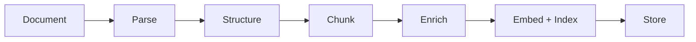

<div align="center">
  <h1>Ingestible</h1>
  <p>Turn documents into token-efficient, searchable knowledge stores for AI.</p>
</div>

<p align="center">
  <a href="https://pypi.org/project/ingestible"></a>
  <a href="https://github.com/SimplyLiz/Ingestible/actions/workflows/ci.yml"></a>
  <a href="https://github.com/SimplyLiz/Ingestible/pkgs/container/ingestible"></a>
  <a href="https://pypi.org/project/ingestible"></a>
  <a href="LICENSE"></a>
</p>

---

Instead of dumping 90,000 tokens into an LLM context window, Ingestible gives your AI a **structured map** of the document and **hybrid search** across three indexes — so each query costs ~1,000-2,000 tokens instead.

```
513-page book:  92,598 tokens full  →  ~1,317 tokens per query  (99% reduction)
55-page paper:   4,975 tokens full  →    ~585 tokens per query  (88% reduction)
```

## Install

### Option 1: pip (recommended)

```bash
pip install ingestible                # base install (~50MB) — uses API embeddings
```

To use **local embeddings** (no API keys needed, runs fully offline):

```bash
pip install ingestible[local]         # adds torch + sentence-transformers + ChromaDB (~2GB)
```

> **Which to choose?** Use `ingestible` if you have an OpenAI/Cohere/Voyage API key.
> Use `ingestible[local]` if you want zero cloud dependencies.

Optional extras (combine with comma: `pip install ingestible[local,audio,cloud]`):

| Extra | What it adds |
|-------|-------------|
| `local` | Local embeddings — sentence-transformers, ChromaDB, torch |
| `pgvector` | PostgreSQL pgvector backend — psycopg, pgvector |
| `gemini` | Google Gemini LLM + embeddings — google-genai |
| `audio` | Audio/video transcription — faster-whisper |
| `cloud` | S3, GCS, Azure Blob connectors — boto3, google-cloud-storage, azure-storage-blob |
| `mcp` | MCP server for AI agent integration |
| `watch` | File watcher — watchdog |
| `cohere` | Cohere embedding provider |
| `voyage` | Voyage embedding provider |

### Option 2: Docker

```bash
# Pull and run (includes all dependencies, ready to go)
docker run -d \
  -p 8081:8081 \
  -v ingestible-data:/app/data \
  ghcr.io/simplyliz/ingestible:latest
```

The API and web UI are at `http://localhost:8081`. Data persists via the Docker volume.

With environment variables:

```bash
docker run -d \
  -p 8081:8081 \
  -v ingestible-data:/app/data \
  -e INGEST_ANTHROPIC_API_KEY=sk-ant-... \
  ghcr.io/simplyliz/ingestible:latest
```

Or with docker-compose (clone the repo first for `.env.example`):

```bash
cp .env.example .env    # edit with your API keys
docker compose up -d
```

The container runs behind gunicorn with multiple workers. Monitor via `/health/ready` and `/metrics`.

<details>
<summary>From source (for development)</summary>

```bash
git clone https://github.com/simplyliz/Ingestible.git
cd Ingestible
python3.12 -m venv .venv
source .venv/bin/activate
pip install -e ".[dev]"
```

</details>

## Quickstart

```bash
# Ingest a document (no API keys needed — skips LLM enrichment, builds all search indexes)
ingest add /path/to/document.pdf -v --skip-enrichment

# List ingested documents
ingest list

# Search
ingest search <doc_id> "your query here"

# Parse only — get structured chunks as JSONL, no storage
ingest parse /path/to/document.pdf
```

First run downloads the E5-large-v2 embedding model (~1.3 GB). Runs locally on CPU / Apple Silicon MPS / CUDA.

### With LLM enrichment

Enrichment adds summaries, hypothetical questions, and concept tags to each chunk — significantly improving search precision. One-time cost per document.

```bash
cp .env.example .env   # add your Anthropic or OpenAI API key
ingest add /path/to/document.pdf -v
```

| Document size | Estimated cost (gpt-4o-mini) | Time |
|---------------|------------------------------|------|
| 55 pages | ~$0.01 | ~1 min |
| 500 pages | ~$0.20 | ~5 min |
| 1,000 pages | ~$0.50 | ~10 min |

## How It Works



| Stage | What happens |
|-------|-------------|
| **Parse** | Format-specific extraction → clean markdown. PDF uses IBM Docling for deep layout analysis, PyMuPDF fallback, automatic OCR if text is sparse. |
| **Structure** | Builds hierarchy tree from TOC tables, heading patterns, or page range heuristics. |
| **Chunk** | Splits into 4 levels (L0-L3). Tables and code blocks stay atomic. ~10% overlap. Small trailing chunks get merged. |
| **Enrich** | Bottom-up LLM pass (L3→L0) generates summaries, concepts, hypothetical questions, entities. Skippable. |
| **Embed** | E5-large-v2 vectors (ChromaDB, auto-detected CUDA/MPS/CPU) + BM25 sparse index + concept→chunk mapping. |
| **Store** | JSON file hierarchy under `data/documents/{doc_id}/`. |

**The 4-level chunk hierarchy:**

| Level | What | Size | Purpose |
|-------|------|------|---------|
| L0 | Document overview + TOC + executive summary | ~500-800 tokens | Map of the entire document |
| L1 | Chapters | ~300-500 tokens | Browsing units |
| L2 | Sections | ~200-400 tokens | Section summaries |
| L3 | Passages | ~250-500 tokens | Primary search targets |

**Three search indexes, fused with Reciprocal Rank Fusion (RRF):**

- **Vector** (ChromaDB + E5-large-v2) — semantic meaning
- **BM25** (rank-bm25) — keyword matching
- **Concept index** — direct concept-to-chunk lookup

Passages found by multiple indexes rank higher. No score normalization needed.

## Features

### Core

- **25+ input formats** — PDF, DOCX, HTML, EPUB, PPTX, XLSX, CSV, Markdown, RST, AsciiDoc, plain text, audio, video, images, email, XML, JSON/JSONL, ZIP (Notion, Confluence, generic)
- **4-level chunk hierarchy** — L0 overview → L1 chapters → L2 sections → L3 passages, no mid-paragraph splits
- **Chunking strategies** — paragraph, semantic, recursive, docling
- **LLM enrichment** — summaries, concepts, hypothetical questions, entities, cross-references (one-time cost, skippable)
- **Hybrid search** — vector + BM25 + concept index, fused with RRF. Optional cross-encoder reranking, SPLADE sparse retrieval.
- **Cross-document corpus search** — query across all ingested documents at once
- **Extraction profiles** — auto-detected (paper, article, documentation, general) with tailored enrichment
- **Knowledge graph extraction** — entity-relationship triples from enrichment

### Production

- **Rate limiting** per endpoint tier, configurable
- **Structured JSON logging** and Prometheus metrics (`/metrics`)
- **Docker-ready** — gunicorn with multiple workers, persistent volumes, health checks (`/health/ready`)
- **API auth** — key-based authentication
- **Background ingestion** with checkpoint/resume and file locking
- **Smart re-ingestion** — content-hash dedup, selective re-enrichment (unchanged chunks skip LLM), version archival

### Integrations

- **MCP server** — AI agents (Claude, GPT) can ingest and search directly via Model Context Protocol
- **Cloud storage** — ingest from S3, GCS, Azure Blob (`s3://`, `gs://`, `az://`)
- **Parse mode** — `ingest parse` outputs structured chunks as JSONL without storing. Feed directly to external systems.
- **Export** — JSONL, Parquet, LlamaIndex, LangChain formats
- **File watcher** — `ingest watch` monitors a directory and auto-ingests on changes
- **Retrieval evaluation** — Hit Rate, MRR, Precision@K with synthetic or manual queries
- **Document access control** — per-document access tags, filtered at retrieval time
- **Full data lifecycle audit trail** — ingest, search, delete, export, re-enrich, webhook events logged to JSONL with user identity and timestamps
- **LLM providers** — Anthropic, OpenAI, Gemini, Ollama (local)
- **Embedding providers** — local (sentence-transformers), OpenAI, Cohere, Voyage, Gemini
- **Vector backends** — ChromaDB (default), pgvector, Qdrant
- **Zero cloud dependencies** — with `[local]` extra and `--skip-enrichment`, everything runs offline

### Supported Formats

| Format | Extensions | Notes |
|--------|-----------|-------|
| PDF | `.pdf` | Text + scanned/OCR via Docling |
| Markdown | `.md` | |
| DOCX | `.docx` | |
| HTML | `.html`, `.htm` | |
| EPUB | `.epub` | |
| PowerPoint | `.pptx` | |
| Excel | `.xlsx` | |
| CSV | `.csv` | |
| reStructuredText | `.rst` | |
| AsciiDoc | `.adoc` | |
| Plain text | `.txt` | |
| Audio | `.mp3`, `.wav`, `.m4a`, `.flac`, `.ogg`, `.wma`, `.aac`, `.opus` | ASR via faster-whisper, timestamped |
| Video | `.mp4`, `.mkv`, `.avi`, `.mov`, `.webm`, `.wmv`, `.flv` | Audio extraction + ASR + keyframes |
| Images | `.png`, `.jpg`, `.jpeg`, `.tiff`, `.bmp`, `.webp` | OCR + layout via Docling VLM |
| Email | `.eml`, `.msg` | Headers, body, attachments |
| XML | `.xml` | Structured to markdown |
| JSON | `.json`, `.jsonl` | Object/array rendering |
| ZIP | `.zip` | Auto-detects Notion, Confluence, or generic |

### Extraction Profiles

| Profile | Detects via | Extras |
|---------|------------|--------|
| `paper` | Academic headings (Abstract, Methodology, References...) | Citation extraction, methodology, key findings |
| `article` | HTML/Markdown without academic signals | Executive summary |
| `documentation` | Code blocks, API/install headings, `.rst`/`.adoc` format | Code-aware chunking |
| `general` | Fallback | Standard enrichment |

Override with `--profile <name>`, or enable LLM fallback for ambiguous documents with `INGEST_PROFILE_LLM_FALLBACK=true`.

## Configuration

All settings via environment variables (`INGEST_*` prefix), `.env` file, or `ingestible.toml`.

```bash
# LLM provider (default: anthropic)
INGEST_LLM_PROVIDER=anthropic            # anthropic | openai | gemini | ollama
INGEST_ANTHROPIC_API_KEY=sk-ant-...
INGEST_ANTHROPIC_MODEL=claude-haiku-4-5-20251001
# INGEST_OPENAI_API_KEY=sk-...           # if using openai provider
# INGEST_GEMINI_API_KEY=AIza...          # if using gemini provider
# INGEST_OLLAMA_BASE_URL=http://localhost:11434  # if using ollama (no key needed)

# Embeddings
INGEST_EMBEDDING_PROVIDER=local           # local | openai | cohere | voyage | gemini
INGEST_EMBEDDING_MODEL=intfloat/e5-large-v2
INGEST_EMBEDDING_DEVICE=auto              # auto | cuda | mps | cpu
INGEST_EMBEDDING_DIMENSIONS=              # Matryoshka truncation (empty = full)
INGEST_EMBEDDING_QUANTIZATION=none        # none | binary

# Chunking
INGEST_CHUNKING_STRATEGY=paragraph        # paragraph | semantic | recursive | docling
INGEST_MAX_CHUNK_TOKENS=500
INGEST_CONTEXTUAL_CHUNKING=false

# Search
INGEST_VECTOR_WEIGHT=0.7
INGEST_BM25_WEIGHT=0.3
INGEST_SPARSE_RETRIEVAL=bm25             # bm25 | splade
INGEST_RERANKER_MODEL=                   # cross-encoder model (empty = disabled)

# API & auth
INGEST_API_KEYS=key1,key2               # empty = no auth
INGEST_RATE_LIMIT_INGEST=10/minute
INGEST_MAX_UPLOAD_BYTES=500000000        # 500 MB

# Access control & audit (off by default)
INGEST_ACCESS_CONTROL_ENABLED=false
INGEST_AUDIT_ENABLED=false

# Production
INGEST_LLM_TIMEOUT=120                  # seconds per LLM call
INGEST_LOG_JSON=true                    # structured JSON logging
```

See the [Usage Guide](docs/usage.md) for the full list.

## CLI Reference

```bash
ingest add <path>           # Ingest a file or directory
ingest parse <path>            # Parse only — JSONL to stdout, no storage
ingest list                    # List all ingested documents
ingest search <doc_id> <query> # Search within a document
ingest corpus-search <query>   # Search across all documents
ingest enrich <doc_id>         # Re-enrich without re-parsing
ingest export <doc_id>         # Export (jsonl, parquet, llamaindex, langchain)
ingest versions <doc_id>       # Show document version history
ingest config                  # Show effective configuration
ingest serve                   # Start web UI + API server
ingest watch <dir>             # Watch directory for changes, auto-ingest
ingest cleanup                 # Remove stale checkpoints and temp files
ingest export-cv [doc_id]      # Export to CognitiveVault
ingest eval <doc_id>           # Evaluate retrieval quality
ingest audit                   # View search audit trail
ingest mcp                     # Start MCP server for AI agents
```

<details>
<summary>Ingest options</summary>

```bash
ingest add /path/to/docs/ \
  --profile auto \              # auto | paper | article | documentation | general
  --chunking paragraph \        # paragraph | semantic | recursive | docling
  --parallel 4 \                # concurrent file processing
  --force \                     # re-ingest even if unchanged
  --skip-enrichment \           # skip LLM enrichment
  --no-checkpoint \             # disable checkpoint/resume
  -v                            # verbose logging
```

</details>

<details>
<summary>Parse options</summary>

```bash
ingest parse /path/to/docs/ \
  --profile auto \              # auto | paper | article | documentation | general
  --chunking paragraph \        # paragraph | semantic | recursive | docling
  -o chunks.jsonl \             # output file (default: stdout)
  -v                            # verbose logging to stderr
```

</details>

## Parse Mode

`ingest parse` runs the parsing and chunking pipeline without storing anything. It outputs structured JSONL chunks to stdout or a file — designed for feeding external systems like training pipelines, knowledge graphs, or RAG backends.

```bash
# Single document → stdout
ingest parse paper.pdf

# Directory → file
ingest parse ~/Documents/Papers/ -o chunks.jsonl

# With options
ingest parse paper.pdf --profile paper --chunking semantic -v
```

**What it runs:** Parse → Clean → Structure detection → Chunk → Validate. No embeddings, no search indexes, no enrichment, no storage. Uses a temp directory that's cleaned up after.

**Output format (JSONL):**
```json
{"id": "doc-chunk-001", "doc_id": "paper-a1b2c3", "doc_title": "Paper Title", "content": "The chunk text...", "summary": null, "chapter": "Introduction", "section": "Background", "page_start": 3, "page_end": 3, "concepts": [], "keywords": [], "profile": "paper"}
```

**Use cases:**
- Feeding training data to ML pipelines (e.g., ANCS VBC model training)
- Populating external vector databases
- Building custom RAG systems that handle their own storage
- Batch extraction scripts that need structured text from PDFs

**Compared to `ingest add` + `ingest export`:**

| | `ingest add` + `export` | `ingest parse` |
|---|---|---|
| Storage | Writes to `data/documents/` | Nothing persisted |
| Indexes | Builds BM25 + vector + concept | None |
| Embeddings | Computed and stored | Skipped |
| Output | Export per doc_id | Single JSONL stream |
| Speed | Slower (indexing overhead) | Faster (parse + chunk only) |
| Use case | Search and retrieval | External consumption |

## Compliance & Data Governance

Ingestible is designed for regulated environments. See [COMPLIANCE.md](COMPLIANCE.md) for full details on GDPR, EU AI Act, and ISO mapping.

### On-prem / air-gapped deployment

With `pip install ingestible[local]` and `--skip-enrichment`, **zero data leaves your infrastructure**. No API calls, no cloud dependencies, no external network access. Embeddings run locally, search runs locally, storage is local JSON on disk. This is the strongest compliance posture.

### Standard deployment (with LLM enrichment)

When LLM enrichment is enabled, chunk text (~250-500 tokens each) is sent to the configured LLM provider (Anthropic or OpenAI). Both are EU-US Data Privacy Framework certified. The deploying organization must sign the provider's DPA.

### What's built in

| Capability | Details |
|-----------|---------|
| **Data lifecycle audit** | Every ingest, search, delete, export, re-enrich, and webhook event logged to `data/audit.jsonl` with user identity and timestamps |
| **Deletion proof** | DELETE operations are audit-logged — evidence for GDPR Art. 17 right to erasure |
| **User identity** | `X-User-ID` header (from auth proxy) or bearer token. Propagated to all audit events and structured logs |
| **Access control** | Per-document access tags, filtered at retrieval time (not post-filtering) |
| **Request tracing** | `X-Request-ID` header generated/propagated through all logs |
| **Version-aware search** | Superseded content from old document versions ranked lower, never silently served as current |
| **AI transparency** | AI-generated fields clearly named (`summary`, `hypothetical_questions`, `kg_triples`). Non-AI fields are deterministic |
| **Quality monitoring** | `ingest eval` measures retrieval precision/recall against synthetic or manual test sets |

### EU AI Act classification

Ingestible is a **data processing pipeline**, not an AI system under Art. 3(1). EU AI Act obligations apply to the LLM providers (Anthropic, OpenAI) and to deployers of high-risk systems that use Ingestible as a component — not to Ingestible itself.

## Documentation

- [Architecture Overview](docs/architecture.md) — pipeline stages, data flow, project structure
- [How Search Works](docs/search.md) — vector search, BM25, concept index, RRF fusion
- [Usage Guide](docs/usage.md) — installation, CLI commands, configuration
- [REST API Reference](docs/api.md) — all HTTP endpoints
- [Token Economics](docs/token-economics.md) — why hierarchical retrieval matters, real-world numbers
- [CognitiveVault Integration](docs/cv-integration.md) — export to CognitiveVault
- [Compliance & Data Governance](COMPLIANCE.md) — GDPR, EU AI Act, ISO 27001, Austrian DSG
- [Roadmap](docs/roadmap.md)
- [Changelog](CHANGELOG.md)

## License

[PolyForm Small Business 1.0.0](LICENSE) — free for individuals, small businesses, nonprofits, and open-source projects.

Need a commercial license? See [COMMERCIAL-LICENSE.md](COMMERCIAL-LICENSE.md).
